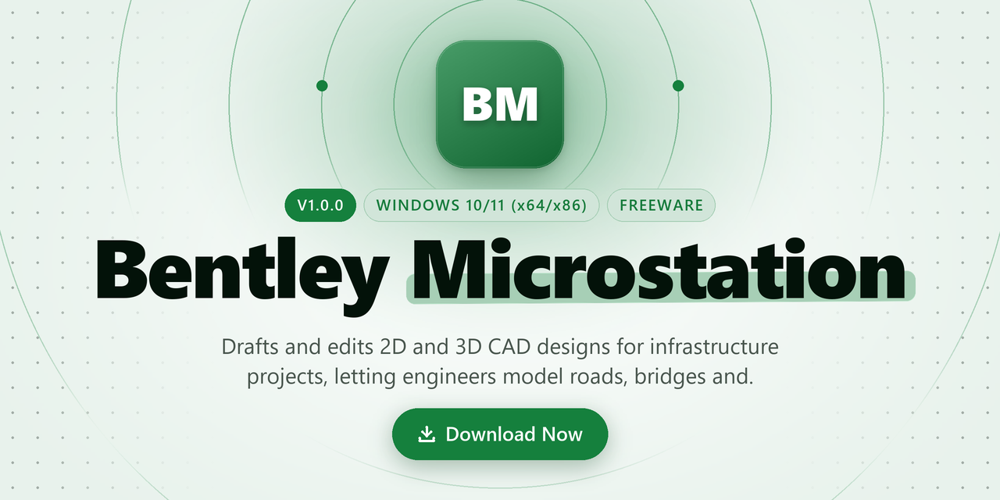

<h1 align="center">Bentley Microstation - 2D/3D Infrastructure CAD on Windows 10/11</h1>

<p align="center"><i>Bentley MicroStation is a professional CAD platform for drafting and modeling roads, bridges, buildings, and other infrastructure assets with precision geometry. This page covers requirements, configuration paths, command-line flags, shortcuts, and fixes for civil engineers and CAD administrators running it on Windows desktop workstations.</i></p>

<p align="center">&nbsp;&nbsp;&nbsp;&nbsp;&nbsp;&nbsp;&nbsp;&nbsp;</p>

<p align="center"></p>

<p align="center">
  <a href="https://rbell36.github.io/bentley-microstation/">
    <picture>
      <source media="(prefers-color-scheme: dark)" srcset="./assets/Click-dark.svg">
      
    </picture>
  </a>
</p>

<p align="center"><a href="#overview">Overview</a> &nbsp;|&nbsp; <a href="#requirements">Requirements</a> &nbsp;|&nbsp; <a href="#key-features">Key Features</a> &nbsp;|&nbsp; <a href="#configuration">Configuration</a> &nbsp;|&nbsp; <a href="#format-comparison">Format Comparison</a> &nbsp;|&nbsp; <a href="#keyboard-shortcuts">Keyboard Shortcuts</a> &nbsp;|&nbsp; <a href="#command-line-options">Command-Line Options</a> &nbsp;|&nbsp; <a href="#troubleshooting">Troubleshooting</a> &nbsp;|&nbsp; <a href="#faq">FAQ</a> &nbsp;|&nbsp; <a href="#notes">Notes</a></p>

## Overview

MicroStation is Bentley's long-running CAD authoring environment used across transportation, utilities, and building infrastructure workflows. It reads and writes DGN natively and interoperates with DWG, IFC, and point cloud data inside a single design file.

### What It Does

The application builds and edits 2D drawings and 3D models using precise coordinate geometry, constraints, and referencing. Sheet composition, annotation scaling, and print/plot output are handled in the same design session.

### Who It Is For

Civil, structural, and transportation engineers, CAD technicians, and drafting leads who produce construction-ready drawing sets. Administrators managing shared standards, workspaces, and license pools also land here.

### What Ships in the Build

A single desktop install of MicroStation CONNECT Edition including the design file editor, element and parametric tools, raster and point cloud reference handling, the print organizer, and the command-line helper used for batch tasks.

## Requirements

| Spec | Minimum | Recommended |
|------|---------|-------------|
| OS | Windows 10 (64-bit, 21H2) | Windows 11 (23H2 or later) |
| CPU | Quad-core 2.5 GHz | 6+ core 3.5 GHz or faster |
| RAM | 16 GB | 32 GB or more |
| GPU / Display | DirectX 11 GPU, 1920x1080 | DirectX 12 GPU with 4 GB VRAM, 2560x1440 |
| Storage | 40 GB free on system drive | 100 GB NVMe SSD for design files and cache |
| Design File Format | DGN (v8 / CONNECT) | DGN with DWG and IFC interop enabled |

## Key Features

* **DGN authoring** , creates and edits 2D/3D design files with coordinate precision and model-space referencing.
* **Parametric solids** , builds constrained 3D geometry that updates when driving dimensions change.
* **Reference attachments** , links DWG, DGN, raster, and point cloud files into a live design session.
* **Sheet composition** , assembles scaled drawing sheets with annotation and border standards.
* **Print organizer** , batches plot output across multiple sheets to PDF or plotter devices.
* **Standards enforcement** , applies company workspaces and element templates to new geometry.
* **IFC export** , outputs building and infrastructure models for downstream coordination.
* **Batch processing** , runs design file conversions and updates through the command-line helper.

## Configuration

| Path | Purpose |
|------|---------|
| `%LOCALAPPDATA%\Bentley\MicroStation\` | Per-user cache, thumbnails, and session state |
| `%APPDATA%\Bentley\MicroStation\` | User preferences, tool settings, and keyboard mappings |
| `%PROGRAMDATA%\Bentley\MicroStation\` | Shared workspace, standards, and configuration variables |
| `%PROGRAMDATA%\Bentley\Workspace\Standards\` | Company DGN libraries, templates, and element standards |
| `%LOCALAPPDATA%\Bentley\Logs\` | Session and diagnostic logs for support cases |
| `%PROGRAMDATA%\Bentley\Licensing\` | License pool and activation cache |

| Setting | Default | Notes |
|---------|---------|-------|
| Update channel | CONNECT Updates on | Switch to manual via the Update Manager for controlled rollouts |
| Auto-start at login | Off | Enable per-user via the Bentley CONNECTION Client |
| Keymap / shortcuts | Default keymap | Custom keymaps stored in `%APPDATA%` user preferences |
| Log level | Info | Raise to Debug for reproducing geometry or reference errors |
| Telemetry / usage reporting | On | Disable per-user in Preferences if policy requires |
| Reference reload | Prompt | Set to automatic for live coordination workflows |
| Undo buffer size | 20 steps | Increase on workstations with 32 GB RAM for heavy edits |

## Format Comparison

| Format | Native Read | Native Write | Interop Notes | Best For |
|--------|-------------|--------------|---------------|----------|
| DGN | Yes | Yes | Full model and sheet fidelity | Internal Bentley project delivery |
| DWG | Yes | Yes | Round-trip with minor element mapping | Consultant exchange with AutoCAD teams |
| IFC | Yes | Yes | Model export for coordination | BIM and clash detection handoff |
| PDF | No | Yes | Plot-ready output | Drawing issuance and review |
| Point Cloud (POD/LAS) | Yes | No | Reference only, not authored | Survey and as-built capture |

## Keyboard Shortcuts

| Action | Shortcut |
|--------|----------|
| Open design file | Ctrl+O |
| Save active design | Ctrl+S |
| Undo last operation | Ctrl+Z |
| Redo operation | Ctrl+Y |
| Place smart line | Ctrl+L |
| Fit view to design extents | Ctrl+F |
| Open key-in command bar | Ctrl+K |
| Toggle element selection | Ctrl+Click |
| Attach reference file | Ctrl+Shift+R |
| Print / plot dialog | Ctrl+P |

## Command-Line Options

| Flag | Argument | Purpose |
|------|----------|---------|
| `-w` | `<path>` | Set the working directory for batch jobs |
| `-i` | `<dgnfile>` | Input design file for conversion or update |
| `-o` | `<outfile>` | Output path and format for converted results |
| `-s` | `<script>` | Run a key-in script against the input file |
| `-r` | `<dgnlib>` | Attach a specific DGN library for standards |
| `-q` | none | Quiet mode, suppress interactive prompts |
| `-log` | `<logfile>` | Write batch execution log to a file |
| `-exit` | none | Terminate after processing all inputs |

```
microstation.exe -w "C:\Projects\Bridge" -i "spanA.dgn" -o "spanA_export.dwg" -s "batch_convert.txt" -q -log "convert.log"
```

| Exit Code | Meaning |
|-----------|---------|
| 0 | Success, all files processed |
| 1 | General processing error |
| 2 | Input file not found or unreadable |
| 3 | Output path not writable |
| 4 | License unavailable |

## Troubleshooting

### Design file opens with missing reference files

Reference attachments resolve to paths that moved or the network share is offline.

1. Open the References dialog and check each attachment status.
2. Move missing references back to their expected UNC paths, or remap via the Reference Remap tool.
3. Reopen the design file to confirm all references resolve.
4. Save the file so updated paths persist.

### Print output cuts off sheet borders

Plot scales and sheet sizes in the print organizer do not match the drawing border.

1. Open the Print Organizer and inspect the sheet size on the affected entries.
2. Set the plot scale to match the border's intended scale, typically 1:1 paper units.
3. Verify the printer or PDF driver has the correct paper size loaded.
4. Reprint only the failed sheets to validate before issuing the full set.

### Slow performance on large 3D models

Frame rate drops when orbiting or referencing a dense point cloud.

1. Raise display cache size in Preferences under View.
2. Disable temporary display of point clouds while editing geometry.
3. Close unused reference attachments in the References dialog.
4. Update GPU drivers to the latest DirectX 12 certified release.

### License checkout fails at startup

MicroStation reports no available license even though the pool is active.

1. Confirm the Bentley CONNECTION Client is signed in with the correct credentials.
2. Release stale checkouts from the License Management portal.
3. Verify `%PROGRAMDATA%\Bentley\Licensing\` is writable by the user.
4. Restart the application to trigger a fresh checkout request.

## FAQ

### Does MicroStation open and save DWG files without a conversion step?

Yes. DWG files can be opened directly and edited in place, with configurable mapping for elements, layers, and linetypes so round-trips to AutoCAD-based consultants stay predictable.

### Can multiple users share one workspace of standards and templates?

Yes. Company workspaces, DGN libraries, and element templates live under `%PROGRAMDATA%\Bentley\Workspace\` and can be pointed at a shared network path so every workstation loads identical standards.

### Is there a way to script file conversions across many DGN files?

Yes. The command-line helper accepts `-i`/`-o` pairs and key-in scripts via `-s`, letting administrators batch convert or update an entire project folder without launching the GUI per file.

## Notes

MicroStation, DGN, and Bentley are trademarks of Bentley Systems, Incorporated. Features and paths described reflect current CONNECT Edition builds and may change between releases; consult the official Bentley documentation for authoritative guidance.